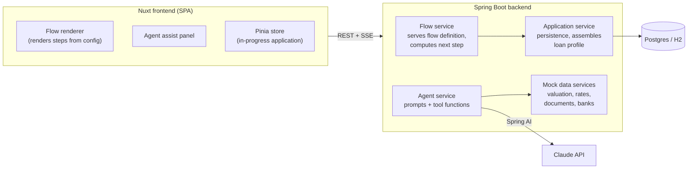

# Intelligent Mortgage Journey

An agent-supported mortgage application journey that turns a complex financial form into
a guided, understandable, cross-device experience.

University semester project (team of 3) built for an SEB project brief. It is an
interactive **prototype**, not production software.

---

## Problem

Applying for a mortgage is one of the most important and complex financial journeys a
customer goes through. It is widely perceived as difficult, time-consuming, and
confusing: unclear terminology, many required inputs, and a fragmented experience across
banks and channels.

## Goal

Design and prototype a mortgage application journey that:

- provides a guided, user-friendly application experience,
- uses an agent-like approach to assist and support the user,
- demonstrates how complex financial forms can be simplified,
- works seamlessly across web and mobile.

Education is delivered **inline within the journey** (just-in-time explanations tied to
the field or concept in front of the user), not as a separate learning phase. A
secondary, mostly conceptual ambition is a standardized "loan profile" that could
conceptually be shared across multiple banks.

## Guiding constraints (from the brief)

- Prioritise **user experience and clarity**, not full regulatory accuracy.
- Use **mock or simplified data** where needed.
- Clearly **demonstrate how the agent improves the journey** — this is the main thing
  being evaluated, alongside a strong final demo.

### In scope

Adaptive multi-step application flow · agent assist layer (explain / validate / read-back
/ chat) · smart pre-fill and suggestions · plain-language validation · standardized loan
profile · a mock multi-bank comparison screen · responsive web + mobile · usability
testing · final demo.

### Out of scope

Real bank APIs · real KYC / identity verification · real credit decisioning · native
mobile apps · production-grade persistence and auth.

---

## Tech stack

| Layer      | Choice                                                                 |
| ---------- | --------------------------------------------------------------------- |
| Frontend   | Vue 3 + Nuxt (run as an SPA, `ssr: false`), Pinia for state          |
| Backend    | Java + Spring Boot, REST + Server-Sent Events                        |
| LLM        | Claude via [Spring AI](https://docs.spring.io/spring-ai/reference/) `ChatClient` (API key stays server-side) |
| Database   | Postgres via docker-compose (H2 acceptable for local dev)            |
| Data       | Mock services: property valuation, interest rates, document checklist, bank catalog |

---

## Architecture



### Frontend

Renders the guided flow **from a config the backend serves** rather than from hardcoded
screens, so the flow can adapt to the user's answers and be tweaked without a frontend
change. Holds the in-progress application in a Pinia store, shows the agent assist panel,
and talks only to the Spring API. Runs as an SPA — SSR is not needed for a prototype and
removes a class of problems.

### Backend modules

- **Flow service** — serves the flow definition; given the answers so far, computes the
  next step. This is where the adaptive flow lives.
- **Application service** — CRUD on the in-progress application, persistence, and
  assembly of the standardized loan profile.
- **Agent service** — wraps Claude via Spring AI; owns all prompts and the tool/function
  definitions.
- **Mock data services** — property valuation, rate table, document checklist, bank
  catalog and fake offer generation.

### The agent is a workflow, not an autonomous loop

The design is a **scripted flow + LLM assists**, not a self-directing agent. The LLM does
four things:

1. **Explain** — plain-language explanation of a term or field, using the user's actual
   numbers.
2. **Validate** — turn rule-based validation results into friendly, specific feedback
   (e.g. "this leaves €140/month after a rate-rise stress test — lenders usually want
   more").
3. **Review / read-back** — at the end, summarise the whole application in human terms
   and flag weak spots.
4. **Chat** — optional free-form Q&A panel.

For 1, 3 and 4 the agent can call backend **functions** (Spring AI function calling) to
get real data: `getPropertyEstimate`, `getCurrentRates`, `calculateAffordability` (with
a rate-rise stress test), `getRequiredDocuments`, `getApplicationSummary`. This is what
makes the assistant feel agentic without the unpredictability of an autonomous loop in a
live demo.

---

## The three contracts

These are the interfaces between the three developers' areas and should be agreed and
frozen early (weeks 1–2) so work can proceed in parallel.

### 1. Flow definition schema

Served by the backend as JSON; the frontend renders it generically.

```jsonc
{
  "steps": [
    {
      "id": "property",
      "title": "About the property",
      "fields": [
        { "key": "address", "type": "text", "label": "Property address", "helpKey": "property-address" },
        { "key": "price",   "type": "money", "label": "Purchase price",  "validation": { "min": 1 } }
      ],
      "next": [
        { "if": { "field": "hasCoApplicant", "eq": true }, "goto": "co-applicant" },
        { "default": "income" }
      ]
    }
  ]
}
```

### 2. Agent API

```
POST /api/agent/chat      (SSE stream)   { applicationId, message }         -> streamed reply
POST /api/agent/explain                  { applicationId, topic | fieldKey } -> { explanation }
POST /api/agent/validate                 { applicationId, stepId }           -> { status, issues[] }
POST /api/agent/review                   { applicationId }                   -> { summary, concerns[] }
```

### 3. Loan profile model

The standardized output; feeds the mock multi-bank comparison screen.

```jsonc
{
  "applicants": [ { "employment": "...", "monthlyIncome": 0 } ],
  "property":    { "type": "...", "value": 0, "location": "..." },
  "loanRequest": { "amount": 0, "termYears": 0, "rateType": "...", "purpose": "..." },
  "financials":  { "downPayment": 0, "ltv": 0, "dti": 0, "stressTestResult": "..." },
  "riskIndicators": [ "..." ],
  "documents": [ "..." ]
}
```

The multi-bank ambition is kept to a **single comparison screen** fed by this profile —
no bank integrations.

---

## Repository structure

```
/backend            Spring Boot application (Gradle)
/frontend           Nuxt application
/docs               Flow definitions, personas, design notes, decision log
docker-compose.yml  Postgres for local dev
```

The frontend dev-proxies `/api` to `localhost:8080`. `ANTHROPIC_API_KEY` lives in a
gitignored `.env` and is read server-side only.

---

## Getting started

> Scaffolding is not in place yet. This section will be filled in as `/backend` and
> `/frontend` are created.

```bash
# Database
docker compose up -d

# Backend  (http://localhost:8080)
cd backend && ./gradlew bootRun

# Frontend (http://localhost:3000)
cd frontend && npm install && npm run dev
```

---

## Team & responsibilities

| Area              | Owns                                                                                     |
| ----------------- | --------------------------------------------------------------------------------------- |
| Frontend          | Flow renderer, assist panel, Pinia state, responsive / mobile, comparison screen        |
| Agent service     | Spring AI integration, prompt design, tool functions, SSE streaming, explanation content, read-back |
| Core backend      | Flow engine + config, application / profile services, mock data services, persistence, OpenAPI contract, validation rules |

One person owns the OpenAPI spec so the frontend can generate types from it.

---

## Roadmap

| Weeks | Focus                                                                                                  |
| ----- | ---------------------------------------------------------------------------------------------------- |
| 1–2   | Pain-point research, personas, flow map, **freeze the three contracts**, repo skeleton, one vertical slice (a step + assist panel + one agent call, end to end) |
| 3–7   | Full flow, all agent behaviours, mock data, validation, comparison screen                            |
| 8–10  | Usability testing with real people, iterate on clarity, responsive polish                           |
| 11–13 | Demo scripting (both personas), write-up, buffer                                                     |
| 14    | Final demo                                                                                          |

### Demo personas

The demo is built around two people walking the **same** flow with very different
experiences:

- a nervous first-time buyer who needs every term explained,
- someone refinancing who knows the jargon and wants to move fast.

---

## Key decisions

| Decision                                             | Rationale                                                                 |
| -------------------------------------------------- | ---------------------------------------------------------------------- |
| Nuxt SPA, not SSR                                  | Prototype doesn't need SSR; avoids a class of hydration / server problems |
| Config-driven flow                                 | Makes the adaptive flow real and demoable without frontend changes      |
| Agent as scripted workflow + LLM assists          | Predictable in a live demo; still agentic via function calling          |
| Spring AI over the raw Anthropic Java SDK          | Natural fit for a Spring Boot team; native function calling; portable   |
| Single comparison screen for "multi-bank"          | Satisfies the brief's conceptual ambition without integrations          |
| Model choice (`claude-opus-5` vs `claude-sonnet-5` + `claude-haiku-4-5`) | **Open** — student API budget vs. prose polish; cache explanation responses regardless |
