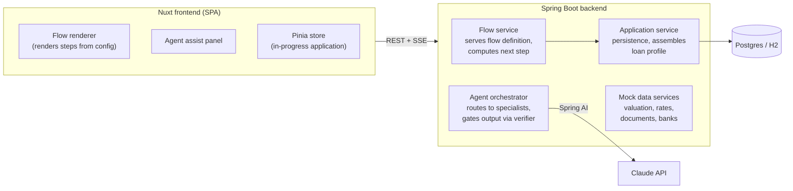

# Intelligent Mortgage Journey

An agent-supported mortgage application journey that turns a complex financial form into
a guided, understandable, cross-device experience.

University semester project (team of 3) built for an SEB project brief. It is an
interactive **prototype**, not production software.

---

## Problem

Applying for a mortgage is one of the most important and complex financial journeys a
customer goes through. It is widely perceived as difficult, time-consuming, and
confusing: unclear terminology, many required inputs, and a fragmented experience across
banks and channels.

## Goal

Design and prototype a mortgage application journey that:

- provides a guided, user-friendly application experience,
- uses an agent-like approach to assist and support the user,
- demonstrates how complex financial forms can be simplified,
- works seamlessly across web and mobile.

Education is delivered **inline within the journey** (just-in-time explanations tied to
the field or concept in front of the user), not as a separate learning phase. A
secondary, mostly conceptual ambition is a standardized "loan profile" that could
conceptually be shared across multiple banks.

## Guiding constraints (from the brief)

- Prioritise **user experience and clarity**, not full regulatory accuracy.
- Use **mock or simplified data** where needed.
- Clearly **demonstrate how the agent improves the journey** — this is the main thing
  being evaluated, alongside a strong final demo.

### In scope

Adaptive multi-step application flow · agent assist layer (explain / validate / read-back
/ chat) · smart pre-fill and suggestions · plain-language validation · standardized loan
profile · a mock multi-bank comparison screen · responsive web + mobile · usability
testing · final demo.

### Out of scope

Real bank APIs · real KYC / identity verification · real credit decisioning · native
mobile apps · production-grade persistence and auth.

---

## Tech stack

| Layer      | Choice                                                                 |
| ---------- | --------------------------------------------------------------------- |
| Frontend   | Vue 3 + Nuxt (run as an SPA, `ssr: false`), Pinia for state          |
| Backend    | Java + Spring Boot, REST + Server-Sent Events                        |
| LLM        | Claude via [Spring AI](https://docs.spring.io/spring-ai/reference/) `ChatClient` (API key stays server-side) |
| Database   | Postgres via docker-compose (H2 acceptable for local dev)            |
| Data       | Mock services: property valuation, interest rates, document checklist, bank catalog |

---

## Architecture



### Frontend

Renders the guided flow **from a config the backend serves** rather than from hardcoded
screens, so the flow can adapt to the user's answers and be tweaked without a frontend
change. Holds the in-progress application in a Pinia store, shows the agent assist panel,
and talks only to the Spring API. Runs as an SPA — SSR is not needed for a prototype and
removes a class of problems.

### Backend modules

- **Flow service** — serves the flow definition; given the answers so far, computes the
  next step. This is where the adaptive flow lives.
- **Application service** — CRUD on the in-progress application, persistence, and
  assembly of the standardized loan profile.
- **Agent package** — a multi-agent backend, not one do-everything agent. Full detail
  (system prompts, grounding, how verification works, how to add a new agent) lives in
  **[`docs/agent-architecture.md`](docs/agent-architecture.md)** — read that before
  touching anything under `backend/.../agent/`. Short version below.
- **Mock data services** — property valuation, rate table, document checklist, bank
  catalog and fake offer generation.

### The agent backend: multiple specialists + an independent verifier

The design is a **scripted flow + narrow LLM specialists**, not a self-directing agent —
there's no autonomous tool-calling loop. Four specialists each do one job, and an
`AgentOrchestrator` routes to the right one:

1. **Explain** (`ExplainAgent`) — plain-language explanation of a term or field, grounded
   on a small hand-written glossary (`Explanations.java`) plus the user's own numbers.
2. **Validate** (`ValidateAgent`) — flags anything that would weaken the application at
   the current step (e.g. "this leaves €140/month after a rate-rise stress test — lenders
   usually want more"), grounded on the applicant's profile.
3. **Review / read-back** (`ReviewAgent`) — at the end, summarises the whole application
   in human terms and flags weak spots.
4. **Chat** (`ChatAgent`) — free-form Q&A about the user's own application, streamed.

A fifth agent, `VerifierAgent`, is independent of all four — it never talks to the user
directly, it only checks a specialist's draft (no numbers outside the profile, no product
recommendations, no advice, calm tone) before the orchestrator lets it reach the client.
Explain/validate/review go through it; chat doesn't, because it streams token-by-token
and there's nothing complete to check before the user starts seeing it (see the doc above
for that tradeoff). Any of the three synchronous agents can also ask the user a **single
short follow-up question** (`followUpQuestion` on the response) instead of guessing, when
what it's been given isn't enough to do the job well.

---

## The three contracts

These are the interfaces between the three developers' areas and should be agreed and
frozen early (weeks 1–2) so work can proceed in parallel.

### 1. Flow definition schema

Served by the backend as JSON; the frontend renders it generically.

```jsonc
{
  "steps": [
    {
      "id": "property",
      "title": "About the property",
      "fields": [
        { "key": "address", "type": "text", "label": "Property address", "helpKey": "property-address" },
        { "key": "price",   "type": "money", "label": "Purchase price",  "validation": { "min": 1 } }
      ],
      "next": [
        { "if": { "field": "hasCoApplicant", "eq": true }, "goto": "co-applicant" },
        { "default": "income" }
      ]
    }
  ]
}
```

### 2. Agent API

```
GET  /api/agent/status                   -> { mode: "stub" | "claude" }
POST /api/agent/chat      (SSE stream)   { applicationId, message }         -> streamed reply
POST /api/agent/explain                  { applicationId, topic | fieldKey } -> { explanation, relatedTopics[], followUpQuestion }
POST /api/agent/validate                 { applicationId, stepId }           -> { status, issues[], followUpQuestion }
POST /api/agent/review                   { applicationId }                   -> { summary, concerns[], followUpQuestion }
```

`followUpQuestion` is `null` unless the agent couldn't do its job well with what it was
given — if set, show it as a small inline prompt and send the reply back as extra context
on a normal follow-up call, not as a new chat thread. Full contract + the DTOs live in
`backend/.../agent/AgentDtos.java` and are mirrored in `frontend/app/types/api.ts`; keep
both in sync when either changes.

### 3. Loan profile model

The standardized output; feeds the mock multi-bank comparison screen.

```jsonc
{
  "applicants": [ { "employment": "...", "monthlyIncome": 0 } ],
  "property":    { "type": "...", "value": 0, "location": "..." },
  "loanRequest": { "amount": 0, "termYears": 0, "rateType": "...", "purpose": "..." },
  "financials":  { "downPayment": 0, "ltv": 0, "dti": 0, "stressTestResult": "..." },
  "riskIndicators": [ "..." ],
  "documents": [ "..." ]
}
```

The multi-bank ambition is kept to a **single comparison screen** fed by this profile —
no bank integrations.

---

## Repository structure

```
/backend                    Spring Boot 4 / Java 25 API (Gradle wrapper included)
/backend/Dockerfile         multi-stage build -> runnable jar
/frontend                   Nuxt 4 SPA (Vue 3, Nuxt UI, Pinia)
/frontend/Dockerfile        multi-stage build -> Nitro node server
/docs                       decision log, agent architecture reference, demo personas
docker-compose.yml          backend + frontend services (+ optional Postgres profile)
.env.example                copy to .env for the Anthropic API key
```

`ANTHROPIC_API_KEY` is read server-side only, either from the environment or a gitignored
`.env` (`docker compose` also reads a `.env` in this directory automatically). See
`backend/README.md` and `frontend/README.md` for per-service detail, and
**[`docs/agent-architecture.md`](docs/agent-architecture.md)** for how the agent backend
is put together.

---

## Getting started

### Option A — Docker (closest to how the mentor/server will run it)

```bash
cp .env.example .env          # fill in ANTHROPIC_API_KEY, or leave blank for the stub
docker compose up --build
```

Frontend: http://localhost:3000 · Backend: http://localhost:8080. Everything (H2, both
services) runs in containers — nothing else to install. Add `-d` to run detached; `docker
compose down` to stop.

### Option B — Local dev (hot reload)

```bash
# 1. Backend — http://localhost:8080  (runs on in-memory H2, no DB setup needed)
cd backend && ./gradlew bootRun

# 2. Frontend — http://localhost:3000  (proxies /api to the backend)
cd frontend && npm install --legacy-peer-deps && npm run dev
```

Open http://localhost:3000 and start a journey.

**No API key yet?** The app runs anyway: the agent falls back to a deterministic stub
(canned explanations, rule-based validation, a templated read-back). `GET
/api/agent/status` shows `stub` or `claude`. When the mentor provides the key:

```bash
cd backend && ANTHROPIC_API_KEY=sk-ant-... ./gradlew bootRun
```

`npm install` needs `--legacy-peer-deps` — npm 10.9.x crashes on Nuxt UI's optional-peer
set otherwise.

### What works today

The full journey runs end to end on mock data: the adaptive flow (co-applicant,
self-employed and fixed-rate branches), inline explanations, rule-based validation with
plain-language messages, the streaming assist chat, and the final screen with the
read-back, standardized loan profile, mock multi-bank offers and document checklist. The
agent backend is a multi-agent design (explain/validate/review/chat specialists + an
independent verifier) — see `docs/agent-architecture.md`. The whole stack also runs via
`docker compose up --build`. Not yet built: the landing-page hub and the in-journey
step-roadmap sidebar (see `docs/decisions.md`, 2026-09-17), and the frontend side of the
follow-up-question mechanism.

### Keeping up to date with the rest of the team

This repo, not any one person's chat history, is the source of truth for design
decisions. If you're picking this project back up (including asking your own Claude Code
session to help):

- **`docs/decisions.md`** — dated log of settled decisions, newest first. Read this first.
- **`docs/agent-architecture.md`** — current-state reference for the agent backend:
  what each agent does, how grounding and verification work, and the recipe for adding a
  new agent.
- **`docs/personas.md`** — the two demo personas the UX is designed around.

When you settle something new as a team, add a dated entry to `docs/decisions.md` (and
update `docs/agent-architecture.md` if it changes how the agent backend works) in the
same PR — don't leave it only in a chat transcript someone else can't see.

---

## Team & responsibilities

| Area              | Owns                                                                                     |
| ----------------- | --------------------------------------------------------------------------------------- |
| Frontend          | Flow renderer, assist panel, Pinia state, responsive / mobile, comparison screen        |
| Agent service     | Spring AI integration, per-specialist prompt design, the verifier, SSE streaming, explanation content, read-back |
| Core backend      | Flow engine + config, application / profile services, mock data services, persistence, OpenAPI contract, validation rules |

One person owns the OpenAPI spec so the frontend can generate types from it.

---

## Roadmap

| Weeks | Focus                                                                                                  |
| ----- | ---------------------------------------------------------------------------------------------------- |
| 1–2   | Pain-point research, personas, flow map, **freeze the three contracts**, repo skeleton, one vertical slice (a step + assist panel + one agent call, end to end) |
| 3–7   | Full flow, all agent behaviours, mock data, validation, comparison screen                            |
| 8–10  | Usability testing with real people, iterate on clarity, responsive polish                           |
| 11–13 | Demo scripting (both personas), write-up, buffer                                                     |
| 14    | Final demo                                                                                          |

### Demo personas

The demo is built around two people walking the **same** flow with very different
experiences:

- a nervous first-time buyer who needs every term explained,
- someone refinancing who knows the jargon and wants to move fast.

---

## Key decisions

| Decision                                             | Rationale                                                                 |
| -------------------------------------------------- | ---------------------------------------------------------------------- |
| Nuxt SPA, not SSR                                  | Prototype doesn't need SSR; avoids a class of hydration / server problems |
| Config-driven flow                                 | Makes the adaptive flow real and demoable without frontend changes      |
| Agent as scripted workflow + narrow LLM specialists | Predictable in a live demo; grounded on a curated glossary + the applicant's own profile, not free model knowledge |
| Independent verifier agent gates explain/validate/review | Mentor guidance: catch fabricated numbers/advice before they reach the client; chat is exempt because it streams |
| Spring AI over the raw Anthropic Java SDK          | Natural fit for a Spring Boot team; portable ChatClient abstraction   |
| Single comparison screen for "multi-bank"          | Satisfies the brief's conceptual ambition without integrations          |
| Docker Compose for backend + frontend              | Mentor runs the app on their own server once it's containerised, and supplies the API key then |
| Model choice (`claude-opus-5` vs `claude-sonnet-5` + `claude-haiku-4-5`) | **Open** — student API budget vs. prose polish; cache explanation responses regardless |
